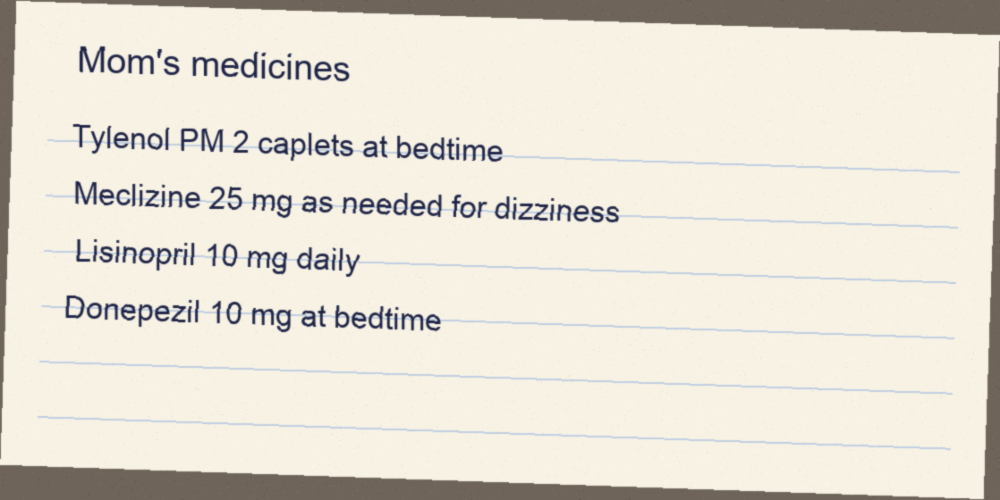

# MedBurden

**A family caregiver pastes or photographs a loved one's medicine list and gets plain-English questions to ask the doctor about drugs that can worsen memory, confusion and falls.**

> **This is a prototype and not medical advice. Always talk to a doctor or pharmacist before changing any medication.**

Veritas AI International High School Hackathon, Health track. Team: [TEAM NAMES, SCHOOL, CONTACT: fill in].

## The problem

About 7.4 million Americans age 65 and older are living with Alzheimer's disease in 2026 ([Alzheimer's Association, 2026 Facts and Figures](https://www.alz.org/alzheimers-dementia/facts-figures)). Family members often manage the pill box. Some common medicines, including over-the-counter sleep aids such as Tylenol PM and some bladder drugs, have anticholinergic effects. In a large UK study, the highest cumulative exposure to strongly anticholinergic drugs was linked to a higher chance of a dementia diagnosis (adjusted odds ratio 1.49, 95% CI 1.44 to 1.54; Coupland et al., [JAMA Intern Med 2019](https://doi.org/10.1001/jamainternmed.2019.0677)). That study shows an association, not proof of cause. Caregivers rarely have the drug tables doctors use. MedBurden turns those tables into a short list of questions to bring to an appointment.

## What makes it different from asking ChatGPT

Every flag comes from a fixed lookup in published tables (the ACB scale and the AGS Beers Criteria), not from a language model's memory. The AI is only used to read the list and to reword flags it is handed. On our 31 held-out lists, a plain LLM got the total ACB score exactly right 39% of the time, while MedBurden got it right 97% of the time, and MedBurden raised no false Beers flags (LLM only: 7 false flags). This matters for dementia caregivers because a total anticholinergic score is the number that tells them whether several mild drugs add up to a problem. The tradeoff is real: the LLM recognised more rare brand names (see Results).

## Demo

Sample inputs in [`demo/`](demo/) (made-up, generated by `scripts/make_demo_images.py`):



Run `streamlit run app/app.py` to see the app. [ADD DEMO GIF OR APP SCREENSHOTS HERE]

## How it works

```
 photo / pasted list
        |
        v
 1. Extract    LLM (optional) reads the list. No key: rule-based parser (text) or Tesseract OCR (photos).
        |      The caregiver reviews and edits the list.
        v
 2. Normalize  Clean the name, then RxNav exact -> local brand map -> RxNav approximate (close names only)
        |      -> spelling fix (shown to the user) -> otherwise "please confirm" or "not identified"
        v
 3. Score      Rules only, no LLM: data/acb_scale.csv (ACB 2012), data/beers_2023*.csv (Beers 2023),
        |      duplicate ingredients, stacked sedating drugs
        v
 4. Report     Risk table, ACB meter, "Questions for your doctor" (text or PDF).
               Optional AI summary, written only from the flags and rejected if it names other drugs.
```

The output is questions to ask a doctor, such as "Could any of them be swapped for one with less anticholinergic effect?". The app never tells anyone to stop a medicine. Medicines it cannot identify are never scored, and the app says so.

## Results

Two evaluations, both on made-up lists labeled by hand by the team (the same people who wrote the tables, so these test whether the rules are applied correctly, not whether the tables are clinically complete).

### Held-out set: 31 lists, 91 real drugs (brand names not in the local brand map)

| | MedBurden | LLM only (gpt-6-luna) |
|---|---|---|
| Ingredient match | 87% (79/91) | 97% (88/91) |
| ACB total exactly right | 97% (30/31) | 39% (12/31) |
| Beers precision (flags that are real) | 100% (82/82) | 91% (70/77) |
| Beers recall (real flags found) | 86% (82/95) | 74% (70/95) |
| False Beers flags | 0 | 7 |

Source: [`results/holdout/metrics.json`](results/holdout/metrics.json), produced by `python scripts/evaluate.py --eval-dir tests/eval_set_holdout --out-dir results/holdout` with an OpenAI key. The LLM-only column varies a few points between runs (ACB 35 to 39%, Beers recall 74 to 84% over three runs) because the model is not deterministic. MedBurden's rule-based part does not vary. Re-run without any key (built-in parser instead of AI text reading), MedBurden gets 86% ingredient match (78/91) and the same ACB 97% and Beers 100% / 86%.

### Main set: 30 lists (6 as photos), partly in-sample

The local brand map was built to cover these drugs, so treat this as a smoke test, not a fair test.

<!-- RESULTS:START -->
**Run conditions:** extraction = {'llm:openai': 30}; RxNav = NOT reachable (cache + local brand map only); LLM = openai · gpt-6-luna; OCR = Tesseract not installed. Photo reading without an AI key needs the free Tesseract OCR program. Install it with `brew install tesseract` (Mac) or `sudo apt install tesseract-ocr` (Linux). On Streamlit Cloud it is installed from packages.txt. You can also type or paste the list instead.

| System | Drug extraction (precision / recall) | Ingredient match (exactly right) | ACB total exact | Beers precision | Beers recall |
|---|---|---|---|---|---|
| MedBurden (rules + tables) | 100% / 100% | 99% (90/91 real drugs matched with exactly the right ingredients) | 100% | 100% | 100% |
| LLM only (gpt-6-luna, no tables) | n/a | 100% | 37% | 96% | 81% |

- Fictional drug names correctly left unmatched: **2/2** (wrongly matched: 0).
- Beers counts (MedBurden): {'tp': 63, 'fp': 0, 'fn': 0}.
- Medicines that are unmatched or need review are never scored. MedBurden does not guess.
<!-- RESULTS:END -->

Without an AI key and without Tesseract installed, the 6 photo lists cannot be read, and the same run drops to ACB 83% and Beers recall 73% (precision stays 100%).

### Reading these numbers honestly
- The LLM alone recognises more obscure brand names. MedBurden refuses to guess and sends most of the 12 it misses to "needs review". It is better at the ACB total and never raised a false Beers flag in either set.
- MedBurden's Beers misses all come from names it declined to guess, not from wrong rules.
- Two wrong matches were found on the held-out set and fixed afterwards, with regression tests in `tests/test_normalize_strict.py`: the made-up "Nexaprine" matched a real combination drug, and "Librium" was spell-corrected to "lithium". The held-out set was therefore used to fix bugs, so it is no longer fully untouched.

### A real failure
Held-out list h12 (patient age 80, dementia, falls): `Librium 10mg tid prn`, `Zyloprim 100mg`, `Colcrys 0.6 mg daily`. Librium is an older brand of chlordiazepoxide, a benzodiazepine that Beers says to avoid (three flags: general, dementia, falls). MedBurden did not match "Librium": it is not in the local brand map, RxNav was not used in that run, and the spelling fixer is limited to close names. The item was marked "please confirm" and the app asked the user what it contains, but all three Beers flags were missed. This is the designed behavior (do not guess), and it is also a real miss. Similar misses: Pexeva (paroxetine), Cordarone (amiodarone), Tenex (guanfacine), Luminal (phenobarbital). Full list: [`results/holdout/beers_misses.csv`](results/holdout/beers_misses.csv).

## Limitations
- **Small test set.** 31 held-out lists and 30 main lists, all made up and labeled by the team. The numbers show a trend, not a measured clinical accuracy.
- **Ingredient matching vs LLM-only.** MedBurden matches fewer real drugs (87% vs 97%) because it refuses to guess. Missed names mean missed flags, so a short list of risky drugs can look cleaner than it is when a drug shows as "please confirm".
- **Photo reading can fail.** AI reading or Tesseract OCR can misread blurry, angled or handwritten labels. The caregiver must check the extracted list before scoring. Without a key or Tesseract, photos cannot be read at all and the app asks the user to type the list.
- **The tables do not cover every drug.** The ACB list has 99 scored ingredients (plus 7 reviewed and not added). A drug not on a list is not proof that it is safe. US drug names only (RxNorm).
- **Beers has exceptions** (indication, duration, dose). Only those checkable from a list are applied (doxepin up to 6 mg, digoxin up to 0.125 mg, extended-release nifedipine, dipyridamole with aspirin). Others are shown as notes.
- The "ACB total of 3 or more is high" cutoff is a threshold widely used in research. The 2012 scale document does not state it.
- **Not validated for real clinical use.** It has not been tested on real patient lists or with clinicians or caregivers.
- No real patient data was used. All lists and photos are made up.

## Run it in 3 commands

```bash
git clone <this repo URL> && cd <repo folder>
pip install -r requirements.txt
streamlit run app/app.py
```

No API key is needed. Typed lists, the demo cases and the evaluation page work without one. Photos need either an AI key or the free [Tesseract](https://github.com/tesseract-ocr/tesseract) program (`brew install tesseract` on Mac, `sudo apt install tesseract-ocr` on Linux). To turn on AI photo reading, the AI summary and the LLM-only baseline, set `OPENAI_API_KEY` or `ANTHROPIC_API_KEY` (environment variable or `.streamlit/secrets.toml`, see `secrets.toml.example`; never commit it). Defaults are `gpt-6-luna` (OpenAI) and `claude-sonnet-5-5` (Anthropic); override with `OPENAI_MODEL` / `ANTHROPIC_MODEL`.

Tests (90 pass, 4 skipped when no key or OCR): `python -m pytest -q`. Full evaluation: `bash run_all.sh`. On Streamlit Community Cloud, set the main file to `app/app.py` and put the key in App settings, Secrets.

## Development timeline

[DRAFT FOR THE TEAM TO REVIEW AND EDIT. This must be true.] File dates in this repo show that the project folder, the first versions of the app, the data tables, the sample images and the evaluation sets were created on Nov 11 and 12, 2026, before the hackathon window opened (Nov 14, 12:00 AM ET). During the window (Nov 14 to 15) the work was: [EDIT: for example the held-out set of 31 lists, the stricter ingredient matching fixes, the RxNav cache, extra tests, the README and this audit]. The tables were transcribed from the published sources listed below. [EDIT: say who did what and which parts the AI coding tool wrote.]

## Credits

**Data and sources**
- ACB scale: Boustani M, Campbell N, Munger S, Maidment I, Fox C. [Anticholinergic Cognitive Burden Scale, 2012 update](https://www.hii.iu.edu/resources/anticholinergic-cognitive-burden-scale.pdf). Aging Brain Care.
- AGS Beers Criteria: 2023 AGS Beers Criteria Update Expert Panel. J Am Geriatr Soc 2023;71(7):2052-2081. [doi:10.1111/jgs.18372](https://doi.org/10.1111/jgs.18372), open access at [PMC12478568](https://pmc.ncbi.nlm.nih.gov/articles/PMC12478568). Tables 2, 3, 5 and 7. Each row records its printed table row in `beers_row`.
- Drug names: U.S. National Library of Medicine, [RxNorm and the RxNav REST API](https://rxnav.nlm.nih.gov/).
- Drug classes: WHO Collaborating Centre, [ATC/DDD Index](https://atcddd.fhi.no/atc_ddd_index/).
- Statistics cited: [Alzheimer's Association Facts and Figures](https://www.alz.org/alzheimers-dementia/facts-figures); Coupland CAC et al., [JAMA Intern Med 2019;179(8):1084-1093](https://doi.org/10.1001/jamainternmed.2019.0677).
- Images and medication lists: made up by the team, generated with `scripts/make_demo_images.py` and `scripts/make_eval_images.py`. No real patient data.

**Models and APIs**
- OpenAI `gpt-6-luna` ([model page](https://developers.openai.com/api/docs/models/gpt-6-luna)): reads the list, writes the optional summary, and is the LLM-only baseline.
- Anthropic `claude-sonnet-5-5` ([models overview](https://platform.claude.com/docs/en/models/overview)): optional alternative provider. It was not used for the reported results.

**Libraries**: [Streamlit](https://streamlit.io), [pandas](https://pandas.pydata.org), [requests](https://requests.readthedocs.io), [Pillow](https://python-pillow.org), [ReportLab](https://www.reportlab.com/opensource/), [matplotlib](https://matplotlib.org), [pytest](https://pytest.org), [Tesseract OCR](https://github.com/tesseract-ocr/tesseract).

**AI coding tools**: [Claude Code](https://claude.com/claude-code) (Anthropic) was used for development and for the final pre-submission audit. [EDIT: list any other AI tool you used, for example ChatGPT or Codex, with links.]

## Layout
```
app/app.py        Streamlit app (Check, Demo cases, Accuracy, About)
src/              extract.py (LLM / parser / OCR), normalize.py (names, RxNav, brand map), score.py (rules), report.py (questions, PDF)
data/             cited tables, brand map, aliases, demo cases, RxNav cache
demo/             3 made-up sample photos
tests/            pytest, eval_set/ (30 cases), eval_set_holdout/ (31 cases)
scripts/          evaluate, build tables, make photos, warm cache, check brand map
results/          metrics, reports, comparison chart
eval/verify_10.md hand check of 10 cases against the source tables
```

## Disclaimer
This is a prototype and not medical advice. Always talk to a doctor or pharmacist before changing any medication. MedBurden can miss drugs and has not been validated for clinical use.
